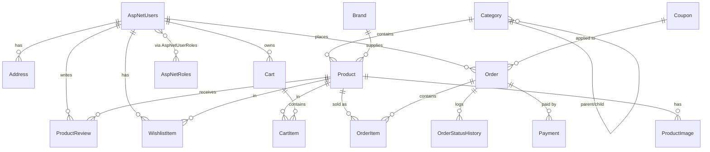

# ECommerce Website — Planning Document (Phase 0)

> Status: **Draft for approval** · Last updated: 2026-09-08
> Nothing in later phases starts until this document is approved.

---

## 1. Goal & Scope

A production-grade e-commerce web application with:

- A **public storefront** (browse, search, filter, product details, cart, wishlist, checkout, order tracking, account).
- An **Admin dashboard** (catalog management, orders, users, CMS content, reports).
- **Cash on Delivery** + a **placeholder online payment gateway**.
- Clean, modern, fully responsive UI (mobile / tablet / desktop).
- A single importable **`Database/ECommerceDB.sql`** that always reflects the current schema + seed data.

Out of scope (for now): multi-vendor marketplace, real payment settlement, shipping-carrier APIs, multi-language storefront, microservices.

> **Currency = "Both" (USD `$` + BDT `৳`).** All product prices are stored in a single **base currency (USD)**. A header **currency switcher** (choice kept in a cookie) formats displayed prices via a stored exchange rate from `SiteSetting`. At checkout the order snapshots `CurrencyCode` + `ExchangeRate` so historical totals never shift. No per-product multi-currency pricing.

---

## 2. Technology Decisions (with justification)

| Concern | Choice | Why |
|---|---|---|
| Framework | **ASP.NET Core 8** | LTS, current standard. |
| Web UI style | **ASP.NET Core MVC + Areas** (not Razor Pages, not Minimal API for pages) | E-commerce has many cross-cutting flows (catalog, cart, checkout, admin). MVC controllers + a dedicated `Admin` **Area** give clearer separation than page-per-file Razor Pages once the app grows. Views use Razor + partials + view components. |
| AJAX endpoints | **Thin API controllers** under `/api/*` (cart add/update, wishlist toggle, newsletter, live search) | These are small JSON operations that don't need a full page render. Returned with proper status codes + a consistent envelope. |
| Database | **Microsoft SQL Server** | Required. |
| ORM | **Entity Framework Core 8** (code-first + migrations) | Required. Migrations during development; the clean `.sql` file is the delivery artifact. |
| Auth | **ASP.NET Core Identity** | Required. Cookie-based auth for the storefront + admin. Roles: `Admin`, `Customer`. |
| Frontend | **Bootstrap 5 + jQuery** ✅ (confirmed) | Fastest path to a consistent responsive layout, huge component ecosystem, works well with server-rendered MVC. jQuery only for small interactions (cart badge, quantity steppers, live search, sliders, currency switcher). |
| Slider | **Bootstrap Carousel** (hero) + a light CSS scroller for product rows | No heavy JS dependency. |
| Validation | **FluentValidation** (Application layer) + Data Annotations on view models | Server-side is source of truth; unobtrusive client validation for UX. |
| Mapping | **AutoMapper** | Entity ↔ DTO ↔ ViewModel without hand-written boilerplate. |
| Logging | **Serilog** (console + rolling file) | Structured logs, easy to configure. |
| Architecture | **Clean / Layered**: Domain → Application → Infrastructure → Web | Testable core, EF and framework concerns pushed to the edges, matches the requested structure. |
| Background/email | **Abstracted `IEmailSender`** with a dev SMTP/file implementation | No hard dependency on a mail provider for local run. |

### Layer dependency rule

```
Domain        →  (no dependencies)
Application    →  Domain
Infrastructure →  Application, Domain
Web           →  Application, Domain, Infrastructure (composition root only)
```

- **Domain**: entities, enums, value objects, domain-level interfaces (e.g. `IAuditableEntity`, `ISoftDeletable`). No EF, no ASP.NET.
- **Application**: DTOs, service interfaces + implementations (business logic), validators, mapping profiles, repository/unit-of-work **interfaces**, result types, pagination helpers.
- **Infrastructure**: `ApplicationDbContext`, entity configurations, migrations, repository implementations, Identity stores, file storage service, email service, seeders.
- **Web**: controllers, areas, view models, Razor views, view components, tag helpers, `wwwroot`, middleware, DI wiring in `Program.cs`.

---

## 3. High-Level Architecture

```
┌────────────────────────────────────────────────────────────┐
│                        Browser (Bootstrap 5 + jQuery)      │
└───────────────┬───────────────────────────┬────────────────┘
                │ HTML (MVC views)          │ JSON (/api/*)
┌───────────────▼───────────────────────────▼────────────────┐
│  ECommerce.Web                                              │
│   • Controllers (storefront)     • Area: Admin              │
│   • API controllers (cart, wishlist, search, newsletter)    │
│   • View Components (Navbar, MiniCart, Breadcrumb, Footer)  │
│   • Middleware (exception handler, request logging)         │
├────────────────────────────────────────────────────────────┤
│  ECommerce.Application                                      │
│   • Services: Catalog, Cart, Order, Checkout, Account,      │
│     Dashboard, Cms, Coupon                                  │
│   • DTOs, Validators (FluentValidation), Mapping profiles   │
│   • Interfaces: IRepository<T>, IUnitOfWork, IEmailSender,  │
│     IFileStorage, ICurrentUser                              │
├────────────────────────────────────────────────────────────┤
│  ECommerce.Infrastructure                                   │
│   • ApplicationDbContext (EF Core) + configurations         │
│   • Repositories + UnitOfWork                               │
│   • Identity integration                                    │
│   • FileStorage (wwwroot/uploads), EmailSender, Seeder      │
├────────────────────────────────────────────────────────────┤
│  ECommerce.Domain                                           │
│   • Entities, Enums, Base classes (AuditableEntity)         │
└───────────────────────────┬────────────────────────────────┘
                            │ EF Core
                    ┌───────▼────────┐
                    │  SQL Server    │
                    └────────────────┘
```

### Cross-cutting concerns

- **Global exception middleware** → friendly error page (storefront) / JSON problem details (`/api/*`).
- **Audit fields** auto-populated in `SaveChanges` override (`CreatedAt`, `CreatedBy`, `UpdatedAt`, `UpdatedBy`).
- **Soft delete** via `ISoftDeletable` + global query filter (`IsDeleted == false`).
- **Pagination** via a shared `PagedResult<T>` and `PagedRequest`.
- **Slugs** generated for categories/products for SEO-friendly URLs (`/product/wireless-headphones`).
- **Guest cart** keyed by an anonymous cookie id; merged into the user cart on login.

---

## 4. Modules

| # | Module | Storefront | Admin | Phase |
|---|---|---|---|---|
| 1 | **Catalog** — Category (multi-level), Brand, Product, ProductImage, Review | listing, filter, sort, search, detail, review submit | CRUD + image upload, feature flags, stock | 4 |
| 2 | **Layout / Navigation** — header, mega/nav menu, breadcrumb, footer | all pages | — | 2 |
| 3 | **Home / CMS** — sliders, featured sections, testimonials, brand logos, newsletter | home page | slider CRUD, testimonial CRUD, subscribers, settings | 5 (CMS admin bits) |
| 4 | **Account / Identity** — register, login, logout, email confirm (dev), profile, address book | account pages | user list, role assign, activate/deactivate | 3 |
| 5 | **Cart** — add / update qty / remove, mini-cart, guest + user cart merge | cart page + mini-cart | — | 6 |
| 6 | **Wishlist** — toggle, list, move to cart | wishlist page | — | 6 (with cart) |
| 7 | **Checkout & Orders** — address select, shipping, coupon, place order, order confirmation, order history + detail, tracking | checkout + orders | order list, status transitions, invoice view | 7 |
| 8 | **Coupons / Discounts** — apply code at checkout | checkout | coupon CRUD | 7 |
| 9 | **Payment** — method selection (COD + online placeholder), payment record | checkout | payment list per order | 9 |
| 10 | **Admin Dashboard** — KPIs (sales, orders, revenue, low stock), recent orders, top products, charts | — | dashboard home | 8 |
| 11 | **Contact / Support** — contact form | contact page | message inbox | 5 |

---

## 5. Database Design (ER level)

### 5.1 Conventions

- PK: `Id` (`int IDENTITY`), except Identity tables (`nvarchar(450)` GUID strings — Identity default).
- Every business table has: `CreatedAt datetime2 NOT NULL`, `CreatedBy nvarchar(256) NULL`, `UpdatedAt datetime2 NULL`, `UpdatedBy nvarchar(256) NULL`.
- Soft-deletable tables add: `IsDeleted bit NOT NULL DEFAULT 0`.
- Money: `decimal(18,2)`.
- All FKs indexed. `Slug`, `SKU`, `OrderNumber`, `Coupon.Code`, `NewsletterSubscriber.Email` are unique.
- Delete behavior: mostly `RESTRICT`/`NO ACTION` to avoid cascade cycles; `OrderItems`→`Order` cascades; `ProductImages`→`Product` cascades.

### 5.2 Entities & key columns

**Identity (ASP.NET Core Identity default schema)**
- `AspNetUsers` — extended by `ApplicationUser`: `FullName`, `PhoneNumber` (built-in), `ProfileImageUrl`, `IsActive bit`, `CreatedAt`.
- `AspNetRoles`, `AspNetUserRoles`, `AspNetUserClaims`, `AspNetUserLogins`, `AspNetUserTokens`, `AspNetRoleClaims`.
- Seeded roles: `Admin`, `Customer`. Seeded admin user.

**Category**
`Id, Name, Slug (unique), Description, ParentCategoryId (FK → Category.Id, null = root), ImageUrl, DisplayOrder, IsActive, IsDeleted, audit…`
Self-referencing for multi-level navigation (max 3 levels used by UI).

**Brand**
`Id, Name, Slug (unique), LogoUrl, IsActive, IsDeleted, audit…`

**Product**
`Id, Name, Slug (unique), ShortDescription, Description (nvarchar max), SKU (unique), CategoryId (FK), BrandId (FK, null), Price, DiscountPrice (null), StockQuantity, IsFeatured bit, IsNewArrival bit, IsActive bit, AverageRating decimal(3,2), ReviewCount int, ViewCount int, IsDeleted, audit…`

**ProductImage**
`Id, ProductId (FK, cascade), ImageUrl, IsMain bit, DisplayOrder`

**ProductReview**
`Id, ProductId (FK), UserId (FK → AspNetUsers), Rating tinyint (1-5), Title, Comment, IsApproved bit, CreatedAt`

**Cart**
`Id, UserId (FK → AspNetUsers, null for guest), AnonymousId nvarchar(64) (null for user), CreatedAt, UpdatedAt`

**CartItem**
`Id, CartId (FK, cascade), ProductId (FK), Quantity int, UnitPriceSnapshot decimal(18,2)` — unique (`CartId`, `ProductId`).

**WishlistItem**
`Id, UserId (FK), ProductId (FK), CreatedAt` — unique (`UserId`, `ProductId`).

**Address**
`Id, UserId (FK), FullName, Phone, Line1, Line2, City, State, PostalCode, Country, AddressType (enum: Shipping/Billing/Both), IsDefault bit, IsDeleted`

**Order**
`Id, OrderNumber (unique, e.g. ORD-20260908-0001), UserId (FK), Status (enum), PaymentStatus (enum), PaymentMethod (enum), SubTotal, DiscountAmount, ShippingCost, TotalAmount, CurrencyCode nvarchar(3) (snapshot, e.g. USD/BDT), ExchangeRate decimal(18,6) (snapshot, base→order currency), CouponCode (null), ShippingAddressJson (snapshot), BillingAddressJson (snapshot), CustomerNote, PlacedAt, audit…`
All monetary columns are stored in the **base currency (USD)**; `CurrencyCode` + `ExchangeRate` are for display/invoice reproduction only.
Address stored as a **snapshot** (JSON/text columns) so later edits to the address book don't rewrite history.

**OrderItem**
`Id, OrderId (FK, cascade), ProductId (FK, restrict), ProductNameSnapshot, SkuSnapshot, UnitPrice, Quantity, LineTotal`

**OrderStatusHistory**
`Id, OrderId (FK, cascade), Status (enum), Note, ChangedAt, ChangedBy`

**Payment**
`Id, OrderId (FK), Method (enum), Amount, Status (enum: Pending/Paid/Failed/Refunded), TransactionId (null), GatewayResponse (null), PaidAt (null), CreatedAt`

**Coupon**
`Id, Code (unique), DiscountType (enum: Percentage/Fixed), DiscountValue, MinOrderAmount, MaxDiscountAmount (null), UsageLimit (null), UsedCount, StartsAt, EndsAt, IsActive, IsDeleted`

**Slider** (hero banners)
`Id, Title, Subtitle, ImageUrl, MobileImageUrl (null), LinkUrl, ButtonText, DisplayOrder, IsActive`

**Testimonial**
`Id, CustomerName, Designation, PhotoUrl, Message, Rating tinyint, DisplayOrder, IsActive`

**NewsletterSubscriber**
`Id, Email (unique), IsActive, SubscribedAt, UnsubscribedAt (null)`

**ContactMessage**
`Id, Name, Email, Subject, Message, IsRead bit, CreatedAt`

**SiteSetting** (key/value singletons — logo, phone, email, address, social links, currency symbol, free-shipping threshold)
`Id, [Key] (unique), [Value], Description`

### 5.3 Enums

- `OrderStatus`: `Pending, Confirmed, Processing, Shipped, Delivered, Cancelled, Returned`
- `PaymentStatus`: `Pending, Paid, Failed, Refunded`
- `PaymentMethod`: `CashOnDelivery, OnlineGateway`
- `DiscountType`: `Percentage, FixedAmount`
- `AddressType`: `Shipping, Billing, Both`

### 5.4 ER Diagram (Mermaid)



### 5.5 Seed data (in `ECommerceDB.sql`)

- Roles: `Admin`, `Customer`.
- Admin user: `admin@ecommerce.local` / `Admin@123` (documented in README; to be changed on deploy).
- ~6 top-level categories (Electronics, Fashion, Home & Living, Beauty, Sports, Books) + a few sub-categories.
- ~5 brands.
- ~24 sample products spread across categories, some flagged `IsFeatured` / `IsNewArrival`, some with `DiscountPrice`.
- 3 hero sliders, 4 testimonials, ~10 site settings (logo, contact, socials, free-shipping threshold, **base currency = USD**, **supported currencies = USD,BDT**, **BDT exchange rate**), 1 sample active coupon (`WELCOME10`).

---

## 6. `.sql` File Strategy

- Development uses EF Core migrations against a local SQL Server.
- After each schema change: `dotnet ef migrations script -i -o Database/_generated_schema.sql`, then the maintained **`Database/ECommerceDB.sql`** is updated to match:
  1. `CREATE DATABASE ECommerceDB` (guarded with `IF DB_ID(...) IS NULL`).
  2. Full schema: tables, PKs, FKs, indexes, constraints, defaults (Identity tables included).
  3. `INSERT` seed data (idempotent — guarded by `NOT EXISTS` / `MERGE` where practical).
- The file is **self-contained**: import it in SSMS / `sqlcmd` and the app runs with a matching connection string. No `dotnet ef database update` required for the reviewer.
- Every phase that touches the model ends with this file regenerated and a note in the phase summary.

---

## 7. Folder Structure (final)

```
ECommerce/
├── ECommerce.sln
├── README.md
├── .gitignore
├── .editorconfig
├── docs/
│   └── Planning.md
├── Database/
│   └── ECommerceDB.sql
└── src/
    ├── ECommerce.Domain/
    │   ├── Common/            (AuditableEntity, ISoftDeletable, BaseEntity)
    │   ├── Entities/          (Product, Category, Order, …)
    │   └── Enums/
    ├── ECommerce.Application/
    │   ├── Common/            (PagedResult, Result, interfaces: IRepository, IUnitOfWork,
    │   │                       IFileStorage, IEmailSender, ICurrentUser, IDateTime)
    │   ├── Mapping/           (AutoMapper profiles)
    │   ├── Catalog/           (DTOs, Services, Validators)
    │   ├── Cart/
    │   ├── Orders/
    │   ├── Checkout/
    │   ├── Accounts/
    │   ├── Cms/
    │   ├── Coupons/
    │   └── Dashboard/
    ├── ECommerce.Infrastructure/
    │   ├── Persistence/
    │   │   ├── ApplicationDbContext.cs
    │   │   ├── Configurations/   (IEntityTypeConfiguration<T> per entity)
    │   │   ├── Repositories/
    │   │   ├── Interceptors/     (AuditableEntitySaveChangesInterceptor)
    │   │   └── Seed/             (DbSeeder)
    │   ├── Identity/           (ApplicationUser, role/user seeding)
    │   ├── Files/              (LocalFileStorage → wwwroot/uploads)
    │   ├── Email/              (DevEmailSender)
    │   ├── Migrations/
    │   └── DependencyInjection.cs
    └── ECommerce.Web/
        ├── Program.cs
        ├── appsettings.json
        ├── Controllers/         (Home, Catalog, Product, Cart, Wishlist, Checkout,
        │                         Order, Account, Contact, Newsletter)
        ├── Areas/
        │   └── Admin/
        │       ├── Controllers/ (Dashboard, Categories, Brands, Products, Orders,
        │       │                 Users, Sliders, Testimonials, Coupons, Subscribers,
        │       │                 Messages, Settings)
        │       └── Views/
        ├── Api/                 (CartApiController, WishlistApiController,
        │                         SearchApiController, NewsletterApiController)
        ├── ViewComponents/      (MainNav, MiniCart, Breadcrumb, FooterInfo,
        │                         CategorySidebar, WishlistBadge)
        ├── Models/              (view models per feature)
        ├── Views/
        │   ├── Shared/
        │   │   ├── _Layout.cshtml            (storefront)
        │   │   ├── _AdminLayout.cshtml
        │   │   ├── _Header.cshtml
        │   │   ├── _Navbar.cshtml
        │   │   ├── _Footer.cshtml
        │   │   ├── _Breadcrumb.cshtml
        │   │   ├── _Pagination.cshtml
        │   │   ├── _ValidationScriptsPartial.cshtml
        │   │   └── Components/…
        │   ├── Home/
        │   ├── Catalog/
        │   ├── Product/
        │   ├── Cart/
        │   ├── Checkout/
        │   ├── Order/
        │   └── Account/
        ├── Middleware/          (ExceptionHandlingMiddleware)
        ├── TagHelpers/          (ActiveRouteTagHelper for nav highlight)
        └── wwwroot/
            ├── css/site.css
            ├── js/site.js  (cart badge, mini-cart, qty stepper, live search)
            ├── lib/         (bootstrap, jquery — via LibMan)
            ├── images/
            └── uploads/     (product images, sliders, brands, avatars — .gitignored)
```

---

## 8. Routing / URL Plan

| Page | URL |
|---|---|
| Home | `/` |
| Category listing | `/c/{categorySlug}` (with `?page=&sort=&brand=&minPrice=&maxPrice=&rating=`) |
| Search results | `/search?q=` |
| Product detail | `/p/{productSlug}` |
| Cart | `/cart` |
| Wishlist | `/wishlist` |
| Checkout | `/checkout` |
| Order confirmation | `/order/confirmation/{orderNumber}` |
| My orders | `/account/orders`, detail `/account/orders/{orderNumber}` |
| Account | `/account/profile`, `/account/addresses` |
| Auth | `/account/login`, `/account/register`, `/account/logout` |
| Admin | `/admin/...` (Area, `[Authorize(Roles="Admin")]`) |
| AJAX | `/api/cart`, `/api/wishlist`, `/api/search/suggest`, `/api/newsletter` |

---

## 9. UI / UX Plan

### 9.1 Design system

- **Grid**: Bootstrap 5 container + 12-col grid. Breakpoints: `sm 576 / md 768 / lg 992 / xl 1200 / xxl 1400`.
- **Color scheme** (CSS variables in `site.css`):
  - Primary `#2563eb` (blue), Accent/Sale `# ef4444` (red), Dark `#111827`, Muted `#6b7280`, Surface `#ffffff`, Body bg `#f8fafc`, Success `#16a34a`.
  - Dark-on-light, generous whitespace, 8px spacing scale, `border-radius` 12px cards / 8px buttons.
- **Typography**: system font stack + optional Google font (`Inter`) with a real fallback.
- **Interactions**: card hover lift + shadow, image zoom on product hover, smooth `transition: .2s`, skeleton loaders, toast notifications for cart/wishlist actions.
- **States**: every list has a **loading** (skeleton/spinner), **empty** (icon + message + CTA), and **error** (retry) presentation.
- **Accessibility**: semantic landmarks, alt text, focus outlines, `aria-label` on icon buttons, color contrast ≥ 4.5:1.

### 9.2 Header (sticky)

```
┌─────────────────────────────────────────────────────────────────────┐
│  [☰ mobile]   LOGO   [  search input …………  🔍 ]  $/৳ ▾  ♡ Wishlist(2) │
│                                                    🛒 Cart(3) $120   │
│                                                    👤 Account ▾      │
└─────────────────────────────────────────────────────────────────────┘
```
- `position: sticky; top: 0; z-index: 1030`; subtle shadow on scroll.
- **Currency switcher** (`USD $` / `BDT ৳`): small dropdown; selection saved to a `currency` cookie; page prices re-format on change (via a shared `Money` display helper / tag helper).
- Account dropdown: logged-out → Login / Register; logged-in → My Orders, Wishlist, Profile, Addresses, (Admin Panel if Admin), Logout.
- Cart & wishlist counts update via `/api/*` without full reload.
- Mobile: logo + hamburger + cart icon; search collapses into a toggle row.

### 9.3 Navbar (below header, also sticky)

- Horizontal category bar on `lg+`: `Home | Electronics ▾ | Fashion ▾ | Home & Living ▾ | … | Deals`.
- Hover/focus opens a **dropdown / mini mega-menu** listing sub-categories (2–3 levels).
- **Active state**: current category/section highlighted (custom `ActiveRoute` tag helper).
- Mobile: slide-in **off-canvas** drawer with collapsible accordion category tree.
- Data source: `Category` tree via a cached `MainNav` view component.

### 9.4 Breadcrumb

- Partial `_Breadcrumb.cshtml` driven by a `BreadcrumbViewModel` (`List<(string Text, string? Url)>`).
- Shown on every page except Home. Examples:
  - `Home / Electronics / Headphones`
  - `Home / Electronics / Headphones / Wireless Noise-Cancelling Headphones`
  - `Home / My Account / Orders / ORD-20260908-0001`
- Uses `<nav aria-label="breadcrumb">` + schema.org `BreadcrumbList` microdata.

### 9.5 Footer (multi-column)

```
┌───────────────┬───────────────┬───────────────┬───────────────────────┐
│ About         │ Quick Links   │ Customer Svc  │ Newsletter            │
│ short blurb   │ - Home        │ - My Account  │ [ email ……… ][Sub]    │
│ contact addr  │ - Shop        │ - Track Order │ social: f  x  ig  in  │
│ phone / email │ - Deals       │ - Returns     │                       │
│               │ - Contact     │ - FAQ         │                       │
├───────────────┴───────────────┴───────────────┴───────────────────────┤
│  Trust badges: Secure Payment · COD Available · Easy Returns          │
│  © 2026 ECommerce. All rights reserved.        [payment method icons] │
└──────────────────────────────────────────────────────────────────────┘
```
- Content (address, phone, socials) pulled from `SiteSetting`.
- Newsletter form posts to `/api/newsletter` (AJAX, inline success/error).

### 9.6 Home Page sections (top → bottom)

1. **Hero slider** — Bootstrap carousel, 3 slides from `Slider` table, each with heading, sub-text, CTA button, background image (separate mobile image), autoplay + swipe + indicators.
2. **Trust/feature strip** — 3–4 icons: Free shipping over $X · Cash on Delivery · 7-day Returns · Secure Checkout.
3. **Featured Categories** — responsive card grid (image + name + product count), links to `/c/{slug}`.
4. **Deals of the Day** — products with `DiscountPrice`, each showing a **countdown timer** + discount %; horizontal scroll on mobile.
5. **Featured Products** — grid of `IsFeatured` products; card = image, name, price (with strikethrough old price), rating stars, "Add to cart" + wishlist heart.
6. **New Arrivals** — grid of `IsNewArrival` products (tabbed by top category, optional).
7. **Special Offers banner** — one or two promo banners (image + CTA), can reuse `Slider` rows tagged as promo or a dedicated setting.
8. **Best Sellers** — top products by units sold (from `OrderItem` aggregation), cached.
9. **Testimonials** — carousel of `Testimonial` rows (avatar, quote, name, rating).
10. **Brand logos** — greyscale logo strip from `Brand`, hover to color.
11. **Newsletter CTA** — full-width band, email capture → `/api/newsletter`.

- All product cards share one `_ProductCard.cshtml` partial for consistency.
- Sections lazy-friendly; images use `loading="lazy"` and fixed aspect ratios to avoid layout shift.

### 9.7 Product card (shared)

```
┌──────────────┐
│  [  image  ] │ ← hover: swap to 2nd image, show quick "♡"
│  -20%  NEW   │ ← badges
├──────────────┤
│ Category     │
│ Product name │ (2-line clamp)
│ ★★★★☆ (42)  │
│ $79.99  $99  │
│ [ Add to cart ]
└──────────────┘
```

---

## 10. Non-Functional / Best Practices

- **Security**: anti-forgery tokens on all POST forms, `[Authorize(Roles="Admin")]` on the whole Admin area, password policy via Identity, HTTPS redirect, secure cookie flags, no secrets in source (`appsettings` + user-secrets for dev).
- **Validation**: server-side always; client-side for UX only.
- **Performance**: `AsNoTracking` for reads, projection to DTOs, output/response caching for nav + home sections, pagination on every list, DB indexes as in §5.
- **File upload**: images only (`.jpg/.jpeg/.png/.webp`), size limit (e.g. 2 MB), unique GUID filenames, stored under `wwwroot/uploads/{entity}/`, path saved in DB. `LocalFileStorage : IFileStorage`.
- **Error handling**: global middleware; storefront → styled error pages (404, 500); API → RFC7807 problem details with correct status codes.
- **Logging**: Serilog structured logs, request logging, errors with correlation id.
- **Testing hooks**: Application services depend on interfaces, so unit tests are possible later (not in scope unless requested).
- **Audit + soft delete**: via interceptor + query filters as described in §3.

---

## 11. API Response Envelope (for `/api/*`)

```jsonc
// success
{ "success": true, "data": { /* payload */ }, "message": null }
// failure
{ "success": false, "data": null, "message": "Human readable error", "errors": { "field": ["..."] } }
```
Status codes: `200` ok, `201` created, `400` validation, `401`/`403` auth, `404` not found, `409` conflict (e.g. out of stock), `500` unexpected.

---

## 12. Phase Plan & Deliverables (recap)

| Phase | Deliverable | Ends with |
|---|---|---|
| **0** | This planning doc | Your approval ✅ |
| 1 | Solution + 4 projects, all entities, `ApplicationDbContext`, configurations, migration, seeder, **`ECommerceDB.sql` v1** | schema + seed review |
| 2 | `_Layout`, sticky header, multi-level navbar (desktop + mobile off-canvas), footer, breadcrumb component, empty home sections | visual review |
| 3 | Identity setup, register/login/logout/profile, roles, `[Authorize]` wiring, admin login | auth review |
| 4 | Admin Category/Brand/Product CRUD + image upload; storefront listing, filter, sort, search, product detail, reviews | catalog review + `.sql` update |
| 5 | Home page fully built (slider, featured cats, deals, featured/new/best, testimonials, brands, newsletter) + CMS admin (sliders, testimonials, settings, subscribers, messages) | home review + `.sql` update |
| 6 | Cart (guest + user, merge on login), mini-cart, wishlist | cart review |
| 7 | Address book, checkout, coupon apply, place order, confirmation, order history + detail, admin order management + status history | order review + `.sql` update |
| 8 | Admin dashboard: KPIs, charts, recent orders, top products, low stock, user management | dashboard review |
| 9 | Payment method selection (COD + online gateway placeholder), `Payment` records, admin payment view | payment review + `.sql` update |
| 10 | Responsive pass, error/empty/loading polish, validation sweep, full `README.md`, final **`ECommerceDB.sql`** | final handover |

Each phase summary will list: **what was done**, **files changed**, **next phase**.

---

## 13. Decisions (resolved)

| # | Question | Decision |
|---|---|---|
| 1 | Frontend | **Bootstrap 5 + jQuery** |
| 2 | Currency | **Both** — base currency USD; header switcher for `USD $` / `BDT ৳`; order snapshots currency + rate |
| 3 | Admin login | **Shared** login page, redirect by role (`Admin` → `/admin`, `Customer` → returnUrl/home) |
| 4 | Sample data | **~24 products / 6 categories** is enough |
| 5 | Register email confirmation | **Auto-confirm** (`RequireConfirmedAccount = false`); dev email sender wired but not enforced |

---

**➡️ Awaiting your approval to start Phase 1 (Database Foundation).**
